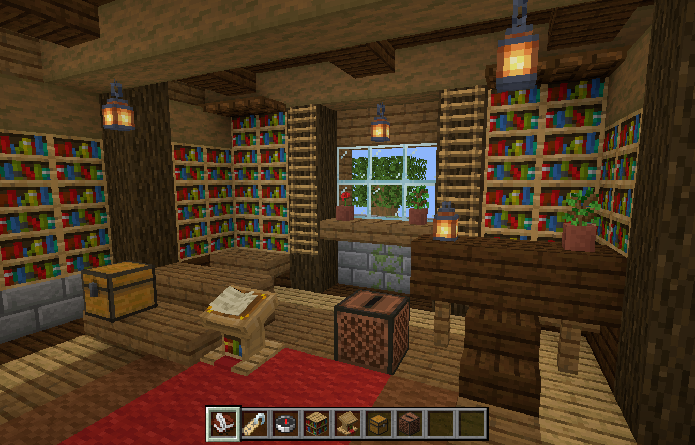

# BlockNotes｜GPT 验收交付书

交付日期：2026-10-10（北京时间）  
产品版本：0.1.0，Windows x64 本地原型  
本次应用源码基线：`8701614`  
视觉与资源参考：Minecraft Java Edition **1.21**

## 1. 给验收者的任务

请作为独立产品验收者和技术审查者，依据本文件、原计划书、AGENTS.md、源码、实机截图及测试日志审查 BlockNotes。开发者的“已实现”与自动测试通过是证据，不等于全部产品要求已经满足。请对功能、数据可靠性、视觉还原度分别给出结论。

请特别检查真正的 3D 方块场景、原版道具比例、书与笔分页、九格栏、暂停与音效，以及笔记创建—保存—存放—读取—搜索闭环。不要把普通像素网页或静态截图评为符合目标；也不要因缺少角色、WASD、生命条或联机扣分，这些不在产品范围内。

建议输出：

1. 总体结论：通过 / 有条件通过 / 不通过，并说明证据覆盖范围。
2. 各验收项：通过 / 失败 / 未验证，附截图文件名、源码路径或日志位置。
3. 问题表：编号、P0/P1/P2、复现步骤、预期与实际、影响、建议修复。
4. 视觉差异单独列出：模型、纹理、灯光、字体、GUI 比例、交互反馈。
5. 下一轮只列必要修复，优先数据问题和核心交互，不扩展无关游戏系统。

只有附件阅读能力时，请给出静态与截图审查结论；没有实际运行 Windows 程序时，不要宣称完成运行、中文 IME、声音听审或性能验收。

## 2. 附件内容与证据位置

| 路径（以验收 ZIP 为根目录） | 内容 |
| --- | --- |
| `交付书.md` | 本文件，可先单独上传给 GPT |
| `requirements/BlockNotes_项目开发计划书.md` | 原始产品与技术总纲，完整保留 |
| `requirements/AGENTS.md` | 当前核心规则，吸收较新的用户修改 |
| `reference/reference-1.png` 至 `reference-4.png` | 用户提供的四张书房空间参考图 |
| `screenshots/` | 当前打包程序的实机界面与细节截图 |
| `evidence/` | 本轮类型检查、单元测试、桌面测试、视觉检查日志及结构化结果 |
| `source/` | Git 跟踪源码快照：渲染、编辑器、SQLite、桌面壳、测试、脚本、依赖锁与技术文档 |
| `manifest.json` | 应用基线、交付文件清单、文件 SHA-256、运行包身份 |

验收 ZIP 是供 GPT 读取的资料包。约 488 MiB 的 Windows 完整运行目录、原版纹理/字体/音频资源包以及用户个人数据库不放入这个附件。源码的本地资源初始化脚本保留。截图中的笔记是隔离测试样例，不是用户日常笔记。

## 3. 产品定义与需求优先级

BlockNotes 是 Windows 本地、离线优先的桌面笔记软件。首页是一间固定、可点击的真正 3D Minecraft 书房；用书与笔写字、书架分类、讲台阅读、箱子归档、命名牌改名和指南针搜索。游戏化空间服务于实际记笔记。

原计划书仍是总纲；与它冲突时，以后续用户要求和当前 AGENTS.md 为准。重要变更如下：

- 保留已接受的 **Electron** 架构，不要求本轮迁回计划书建议的 Tauri。
- 以 Java 1.21 原版视觉与交互为统一标准，目标尽可能 1:1；私人本机使用原版模型、纹理、GUI、字形和原始音效。本地资源独立管理，代码许可与游戏资源来源分别记录。
- 房间按四张参考图的空间设计逻辑重建，不将图片当背景。约 11×9×6 起步，现为 11×10×6。
- 不开发角色、自由移动、WASD、战斗、联机、云账号和 AI 功能；鼠标只有有限平滑视差。弹窗与暂停菜单冻结场景交互。
- 首页去掉宣传语、品牌装饰和现代网页风布局。设置只从 Esc 菜单进入，保存状态留在书页内；物品名称用即时悬停标签。
- 末页下一页新增空白页，以显式分页节点持久化；长文不能被截断。
- 唱片机只保留 **19 张 Java 1.21 音乐唱片**，此前环境 BGM 已删除；启动不自动播放，暂停菜单暂停音乐。
- 最新文案：命名牌标题为“**给笔记一个名字**”；指南针标题为“**寻找一个笔记**”。

## 4. 当前实现及源码地图

| 模块 | 当前实现 | 主要源码 |
| --- | --- | --- |
| Windows 桌面壳 | Electron 44.7.0、沙箱渲染器、contextIsolation、窄 IPC、本地资源协议、原生文件对话框 | `electron/main.cjs`、`electron/preload.cjs` |
| 3D 书房 | Three.js + React Three Fiber；解析需要的原版 JSON 模型；nearest 像素采样；合并静态几何、射线交互 | `src/Scene.tsx`、`src/minecraft/model.ts` |
| 房间与家具 | 墙/地板/天花、梁柱、嵌入书墙、窗户、盆栽、地毯、桌椅、灯笼、讲台、箱子、唱片机 | `src/minecraft/layout.ts` |
| 光照 | 六向明暗、AO、0–15 级天空/灯笼光及静态遮挡传播 | `src/minecraft/lighting.ts` |
| 游戏 GUI | 九格栏、选中框、原版物品 GUI 姿态、容器、按钮、即时标签和暂停菜单 | `src/App.tsx`、`src/minecraft/gui.ts`、样式文件 |
| 笔记编辑 | 唯一 Tiptap/ProseMirror 内核；完整 JSON 正文；DOM 中文编辑；翻页、空白页、格式/书名/标签次级界面 | `src/BookEditor.tsx` |
| 保存协调 | 450 ms 防抖、串行保存、切换前 flush、失败提示与未完成草稿恢复 | `src/useLibrary.ts` |
| 数据与检索 | SQLite、WAL、事务、migration、revision 乐观锁；中文规范化 substring 检索；归档与软删除分离 | `server/storage.cjs` |
| 备份与导出 | JSON 全量备份、事务合并恢复、冲突另存副本；Markdown 通用导出 | `server/storage.cjs`、`electron/main.cjs` |
| 原声交互 | 官方 OGG 与 sounds.json 事件映射、变体、音高/音量；失败不阻断笔记 | `src/minecraft/sound.ts`、`docs/sound-map.md` |
| 唱片机 | 单路 HTMLAudio 按需流式播放、19 张唱片、进度/切曲/音量、菜单暂停恢复、设置持久化 | `src/Jukebox.tsx`、`src/minecraft/music.ts`、`electron/local-media.cjs` |
| 播放 HUD | 短暂曲名提示、原版音符粒子，暂停冻结、停止取消渲染 | `src/RecordNotice.tsx`、`src/RecordNotes.tsx` |

笔记归属保存在 SQLite，与 3D 坐标解耦；场景配置不读取或修改笔记。没有引入完整 Minecraft 游戏客户端。Three.js、R3F、Tiptap 为实际采用内核；PrismarineJS 部分几何定义有移植来源，其他候选采用/放弃理由见 `source/docs/reuse-map.md`。依赖版本以 package-lock.json 为准。

## 5. Windows 实际运行与验收步骤

本机最新版完整目录：

```text
<项目根目录>\release\wording-fix\win-unpacked\
```

从旧版 Esc 菜单“保存并退出”后，双击该目录的 `BlockNotes.exe`。必须保留完整目录，不单独移动 exe。默认数据位于 `%APPDATA%\blocknotes\`，实际路径在 Esc → 选项显示；更新程序不需要清空或搬移笔记。

推荐验收者使用独立目录运行，避免将样例写进个人笔记库：

```powershell
$env:BLOCKNOTES_DATA_DIR = Join-Path $env:TEMP ('BlockNotes-review-' + [guid]::NewGuid())
& '.\release\wording-fix\win-unpacked\BlockNotes.exe'
```

保留该环境变量与目录，才能检查退出重开后的内容；不要将已有用户数据目录用于破坏性故障测试。

| 顺序 | 实际操作 | 预期 |
| --- | --- | --- |
| 1 | 启动，移动鼠标，检查默认视野 | 完整 3D 房间与九格栏；仅小幅平滑视差；关键方块可识别且可点 |
| 2 | 点击书与笔 / Ctrl+N，输入中文、英文、符号 | 直接进入真实编辑器；等待自动保存或 Ctrl+S 后显示可靠保存结果 |
| 3 | 末页点击下一页，再点上一页；新增空白页并保存 | 新页为空，原正文完整；重开后空白页保留 |
| 4 | “书名与标签”修改名称、标签、归属；关闭后点书架 | 目标书架可看到该书，重开正文与元数据一致 |
| 5 | 点击讲台 | 打开最近笔记阅读，可翻页并返回编辑 |
| 6 | 点击命名牌与指南针 | 标题分别是最新“笔记”文案；名称筛选和标题/正文/标签检索可用 |
| 7 | 搜索中文单字、两字、三字、英文、无结果词 | 短词无明显漏搜；可打开匹配笔记；空态明确 |
| 8 | 归档、恢复、软删除、恢复 | 箱子区分归档与回收；归档仍可搜索；内容和归属不丢失 |
| 9 | 返回书房按 Esc，再进入选项/指引 | 游戏风暂停菜单；相机/场景输入冻结；子界面返回菜单；可安全退出 |
| 10 | 悬停九格栏；点击书架、箱子和翻页按钮 | 即时游戏风标签和选中反馈；相应原声；箱盖开合 |
| 11 | 点击唱片机、第七格；播放、切曲、调音量、暂停 | 仅 19 张唱片；实际时间推进；菜单暂停/返回继续；重启不自动播放 |
| 12 | Esc → 选项导出备份，再合并恢复；导出 Markdown | 备份包含正文及元数据；相同备份不重复；冲突另存，禁止静默覆盖 |
| 13 | 保存并退出，使用同一测试数据目录重开 | 正文、分页、标签、书架、归档和设置保持 |
| 14 | 800×640 与默认窗口；真实中文 IME 输入 | 书页/容器/快捷栏可操作，候选窗与组合输入不被快捷键打断 |

快捷键：1 书与笔、2 命名牌、3 指南针、4 书架、5 讲台、6 箱子、7 唱片机；Ctrl+N 新建、Ctrl+K 搜索、Ctrl+S 保存；Esc 依当前界面关闭容器或打开/返回暂停菜单。

## 6. 测试证据与实测边界

本轮对上述最新版 Windows exe 使用独立临时数据目录重新验证。原始输出在 `evidence/`，不能仅凭本表替代日志检查。

| 项目 | 本轮结果 | 证据 |
| --- | --- | --- |
| TypeScript | 通过 | `check.log` |
| 单元测试 | 24/24：11 存储、8 模型、1 媒体流、4 光照 | `unit.log` |
| 打包 exe 桌面测试 | 6/6，使用实际 Windows exe、真实 IPC/SQLite/WebGL/音频播放 | `e2e.log`、`e2e-results.json` |
| 视觉脚本 | 实际 exe 截图；页面错误 0、外部 HTTP/HTTPS 请求 0 | `visual.log`、`screenshots/` |
| 梯子频闪回归 | 五个视角、两个区域、每区三次后续帧，共 30 次像素哈希一致 | `visual.log`、`ladder-view-0.png` 至 `ladder-view-4.png` |
| 两处文案 | 打包程序实际打开命名牌和指南针，精确标题断言通过 | `copy.log`、`names-copy-fixed.png`、`search-copy-fixed.png` |
| Windows 构建 | 前一轮已完成同源码本地显式打包，本轮复用并重验该 exe，未修改应用代码 | `manifest.json` 的 exe/app.asar SHA-256；前轮记录见会话及技术文档 |

本轮截图脚本首次在关闭书页弹窗时等待超时，原始失败保存在 `visual-first-attempt.log`；未修改应用代码，重新完整运行同一脚本后通过。该次偶发超时的根因尚未定位，验收者可重点复查连续翻页、修改元数据后按 Esc 返回。最终截图来自通过的完整重跑，首次失败没有从记录中删除。

六组桌面测试覆盖：完整笔记闭环与四个场景实体；20 条样例/长文/保存失败/草稿恢复；WebGL 初始化失败后仍可编辑保存；原始 OGG 解码与实际调用指纹；暂停/标签/分页/退出；唱片库/流式播放/音量重启保持及播放中写笔记。

模型测试核对箱盖顶面 UV、箱盖转轴/尺寸、讲台书七部件、箱子物品 GUI 姿态、讲台与灯笼支撑、唱片机不重叠、梯子方向贴片与贴墙间隙。存储测试包含陈旧 revision 拒绝、事务失败、损坏数据库拒绝覆盖、备份冲突合并及 WAL/意外退出恢复。

连续帧检查在采样时临时隔离实机指针输入，避免系统鼠标打断自动化视角；唱片播放与画面绘制继续。此隔离只存在于验收脚本，不是应用功能。截图样例库退出后删除。

## 7. 截图查看顺序与视觉重点

1. `room.png`：完整房间、默认镜头、窗户、梁柱、书墙、灯笼、地毯、家具和核心功能方块。
2. `room-hover.png`：书架射线悬停反馈。
3. `hotbar.png`、`hotbar-tooltip.png`：九格栏、选中框、原始道具图标与即时标签。
4. `book.png`、`book-blank-page.png`、`book-metadata.png`：单页书、翻页和次级笔记功能。
5. `shelf.png`、`chest.png`、`names-copy-fixed.png`、`search-copy-fixed.png`：分类、归档、命名、检索。
6. `pause.png`、`menu-settings.png`、`controls.png`：暂停菜单、选项和操作指引。
7. `jukebox.png`、`room-record-playing.png`：19 张唱片界面、短暂播放提示与音符。
8. `chest-detail.png`、`ladder-fixed.png`、`desk-support-fixed.png`、`lectern-scale-checked.png`：前期用户反馈的专项细节。




参考图是四张用户提供的游戏书房设计图片，其中部分有光影效果/NPC，不能把这些当成本软件必须增加的系统。房间采用其布局逻辑，未逐块复制某一张图。GUI 目前缺少配套的统一分辨率原版游戏对照截图，因此不宣称做过全界面逐像素误差测量。

## 8. 已修复细节与尚存差异

已修复的重点：箱顶使用实体外盖 UV `(28,0)–(42,14)`；讲台独占一格、书本保留原版部件；悬灯连接上方横梁、桌灯落在有效顶面；唱片机位于可见可点且不与栏杆重叠的地面格；梯子方向贴片仅从各自正面绘制，距木柱 0.05 格；桌面底面与桌腿顶面 y=1 相接，桌灯与盆栽有 y=2 支撑。

讲台尺寸专项核对见 `evidence/lectern-audit.json`：底座 16×2×16 像素，立柱 8×13×8，斜面 22.5°，世界缩放 `(1,1,1)`，本体包围盒约 `1×1.15328145×1` 方块。超出一格的高度来自原版旋转，不是额外放大。讲台近景仅辅助判断；数据不替代实际视觉对比。

仍有以下差异/未验证项，请按实际影响评估：

- **光照近似**：静态采样/顶点光照，未使用 Java 游戏完整 LightTexture/gamma/动态世界系统；箱盖开启后仍沿用闭合姿态烘焙颜色，旋转几何用包围盒遮挡，植物无精确叶片阴影。
- **DOM 字体与排版**：原始 bitmap/Unifont 字形转为浏览器字体，Chromium 度量与游戏字体引擎有差异；部分扩展字形可能系统字体回退。
- **书页适应笔记**：没有原版字数上限，允许长文；格式、标签、保存等位于次级界面。不要按游戏有限字数要求判定笔记功能失败。
- **交互适配**：一个书架区域代表分类容器，部分实体点击边界稍放宽；暂停菜单为笔记软件提供返回、选项、指引和保存退出，没有联机/LAN 等无关项。
- **声音验证范围**：原始素材校验和、解码指纹和实际播放时间已验证；未进行声卡输出录音听审或 Java OpenAL 空间衰减逐项对比。
- **人工输入与设备**：中文 DOM 输入已自动验证，真实 Windows IME 候选窗、组合态撤销仍待人工；多显卡、多屏 DPI、低功耗设备和长时间性能尚未实测，无固定 FPS 承诺。
- **发行形态**：已验收的是完整 Windows 解包文件夹；未签名，单 exe portable/NSIS 安装器未验收。源代码附件缺少本地原版资源，直接运行前需初始化资源。
- **构建提示**：Three 场景代码块超过 500 kB 的 Vite 体积提示仍在，场景已独立分块，不能把该提示直接当运行失败。

详细差异与复用依据见 `source/docs/room-design.md`、`source/docs/sound-map.md`、`source/docs/reuse-map.md`。旧 `source/docs/acceptance.md` 是历史记录，其中默认输出目录与日期不代表本次最新版；本交付书与本轮 evidence 为准。

## 9. 可复现开发检查

在完整项目、Node 22.22 或更高及已初始化本地资源的 Windows 环境中：

```powershell
npm ci
powershell -NoProfile -File scripts/setup-local-resources.ps1
npm run check
npm test
npm run build
npm run test:e2e
```

本轮实机验证：

```powershell
$env:BLOCKNOTES_TEST_EXE = (Resolve-Path 'release/wording-fix/win-unpacked/BlockNotes.exe').Path
npm run test:e2e
node scripts/visual-smoke.mjs
```

如果需要自行生成私人本地运行目录，应先确保输出目录未被应用占用，或使用新的独立输出目录：

```powershell
npm run build
npx electron-builder --config electron-builder.local.cjs --config.directories.output=release/review-build --win dir
```

默认打包排除原版资源，私人本地配置才复制独立资源包。官方客户端来源与校验和、代码许可原文见 `source/THIRD_PARTY_NOTICES.md` 和 `source/docs/licenses/`；原版游戏资源不属于这些代码许可。本交付包记录来源，不宣称公开资源发行授权。

## 10. 建议验收判断标准

P0：数据丢失、静默覆盖/清库、失败却显示已保存、无法可靠退出、备份恢复破坏已有内容。

P1：核心闭环不可用、功能方块无法点击、中文编辑严重受阻、分页丢正文/空白页、搜索漏掉目标短词、暂停仍接收场景输入、明显模型/支撑错误、持续频闪、唱片数量或菜单播放逻辑不符。

P2：字体度量/像素对齐、部分光照近似、GUI 细微比例差异、次级界面效率与提示细节。若视觉差异严重偏离原版目标，应提升为 P1，不能以“功能已通”替代视觉验收。

请优先给出能够复现和定位的结论；缺证据时标“未验证”，不要推定通过或失败。
