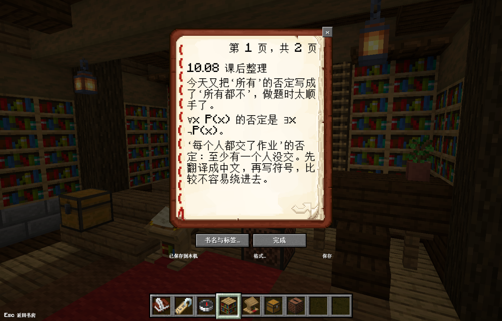
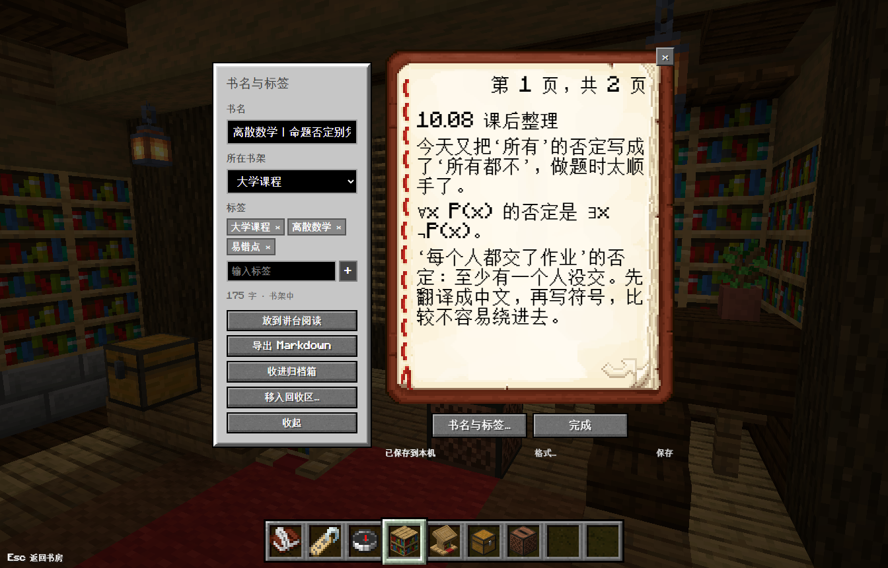
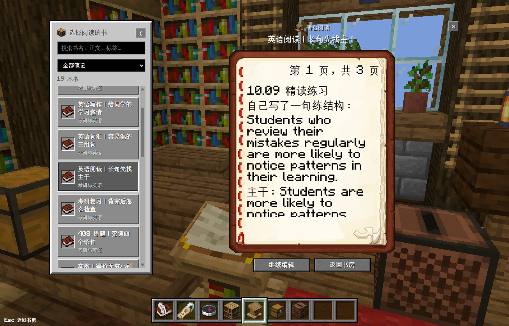
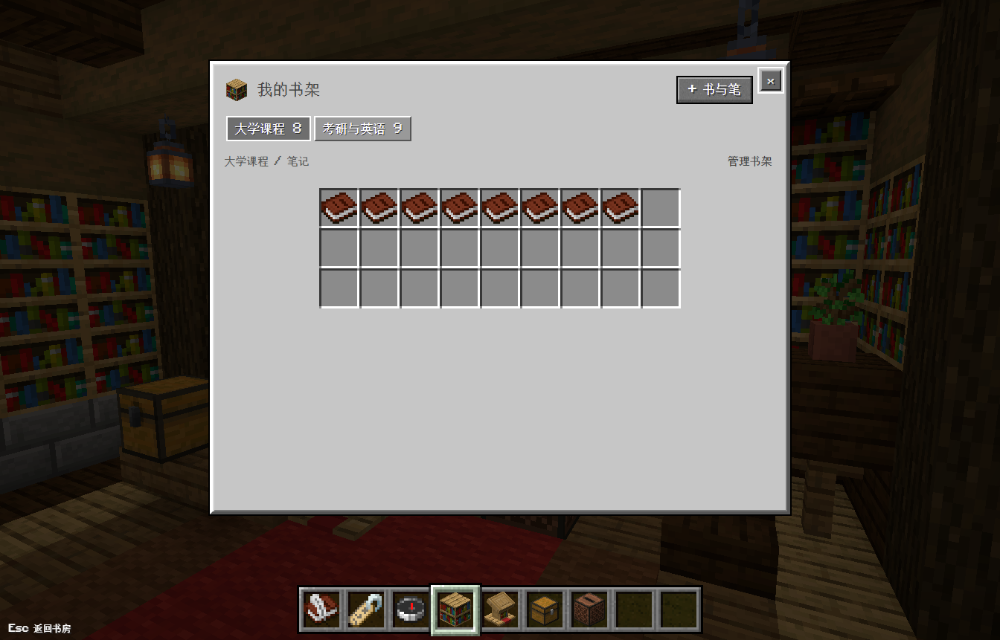
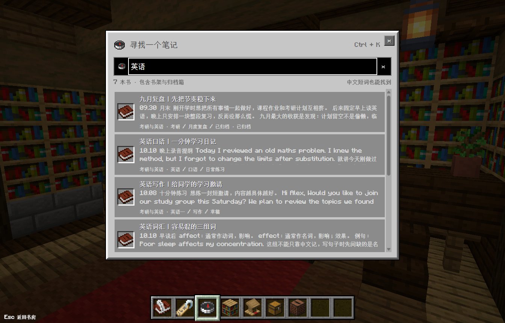
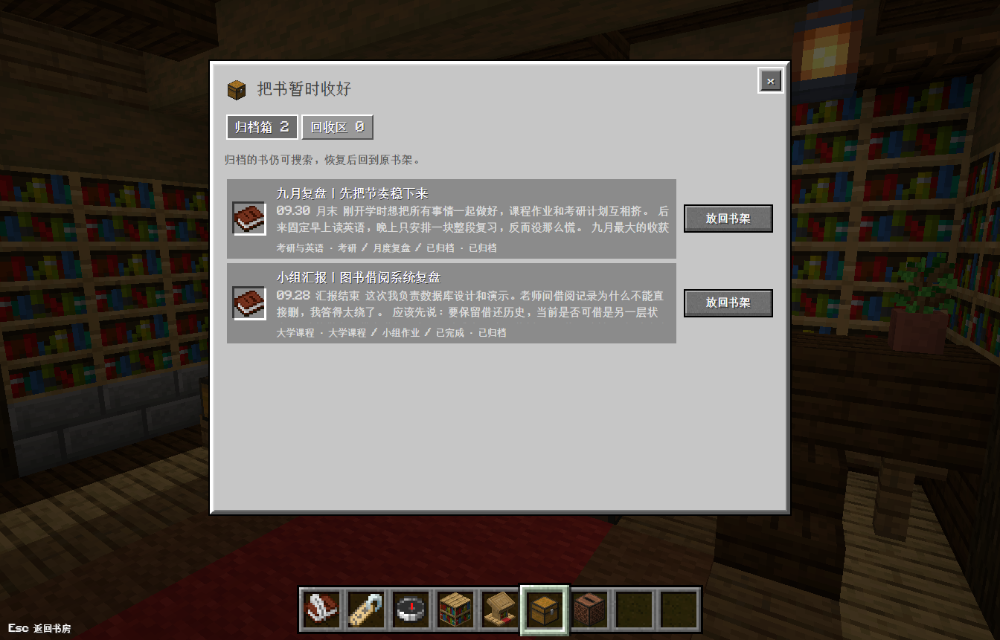
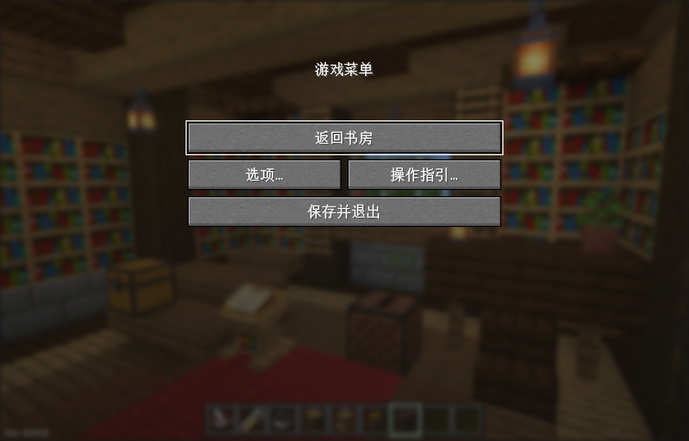
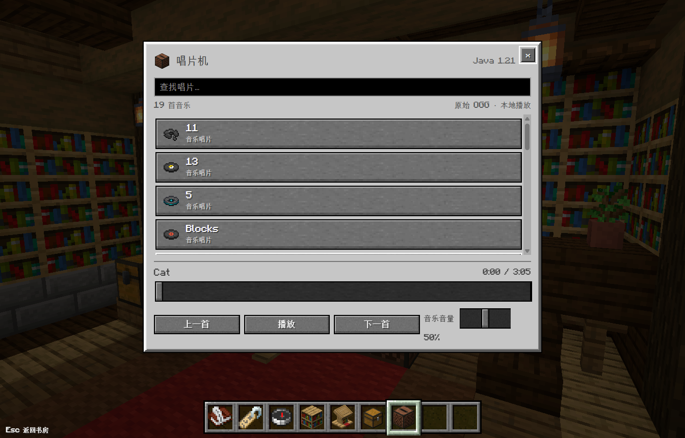

# 使用教程

首次资源准备和下载步骤见 [开始使用](getting-started.md)。以下截图为实际 Windows 应用与虚构学习笔记。

## 1. 写下一篇笔记

点击下方第一格“书与笔”，或按 Ctrl+N，新建一篇空白笔记。点击书页直接输入，支持中文。编辑器自动保存，也可 Ctrl+S 立即保存；只有保存成功才显示成功状态。

打开“书名与标签…”修改标题、添加标签、选择所在书架。“格式…”提供粗体、斜体、小标题、列表、引用和代码块。

点击页角翻页。书与笔末页的下一页会新增空白页，并在保存后保留；很长的正文会自动排版，不截断正文。返回书房前应用等待可靠保存；若保存失败，应保留窗口并处理错误，不能把失败提示当作已经保存。

## 2. 在讲台阅读

点击场景讲台或第五格物品，进入独立 3D 阅读近景。左侧选择笔记，可按书架分类或搜索标题、正文、标签；右侧只读翻页。阅读不会修改正文、创建空白页或提升笔记版本。

收起左侧列表可以专注阅读；点击“继续编辑”返回书与笔。Esc 或“返回书房”回到首页。

## 3. 管理书架

点击书架或第四格物品查看分类和笔记。点击书的图标打开它，悬停可查看书名与内容摘要。通过“管理书架”重命名或新增自定义分类。

自定义分类可以删除；非空时必须选其他书架接收其笔记，正文、归档和回收状态都保留。两个绑定场景的基础书架只允许重命名。

## 4. 搜索与命名

点击指南针或 Ctrl+K，搜索标题、正文及标签。支持中文短词；多个词一起输入时按全部词匹配。归档笔记可以搜索，回收区笔记不在普通搜索结果中。

命名牌按书名筛选；打开笔记后进入“书名与标签…”修改。搜索命中后可直接阅读。

## 5. 归档与删除

在编辑器的“书名与标签…”中点击“收进归档箱”，笔记从日常书架收起，仍可检索。在箱子的归档区选择“放回书架”恢复。

删除入口也在同一侧栏：**“移入回收区…”**。确认后正文保留，箱子切换到“回收区”可恢复。当前版本没有永久删除按钮。

## 6. 备份与恢复

在书房按 Esc → 选项，使用“导出备份”生成包含正文、标签、分类和状态的 JSON。“选择备份并合并”恢复到当前库，不清空已有笔记。

同来源、同内容的重复恢复跳过；同 ID 不同内容保留冲突副本；用户修改过的恢复副本继续保留。大备份在后台流式处理；等待完成提示再关闭。旧 schemaVersion 1 备份保持兼容。

备份保存后应另存到可靠位置。`examples/study-notes.json` 只是文案源，不能作为备份文件恢复。

## 7. 暂停、选项与唱片

书房中 Esc 打开暂停菜单，菜单暂停视角和音乐。容器中 Esc 先关闭当前界面；选项与指引中 Esc 返回暂停菜单。退出使用“保存并退出”。

唱片机位于窗户前、讲台右后方，也可通过第七格打开。选择 19 张唱片中的一张播放，支持上一首、下一首、暂停、进度与独立音量。关闭唱片窗口继续播放；重启只记忆选曲和音量，不自动播放。

## 快捷键

| 按键 | 操作 |
| --- | --- |
| Ctrl+N | 新建笔记 |
| Ctrl+S | 立即保存 |
| Ctrl+K | 全文搜索 |
| 1–7 | 书房中的七个功能入口 |
| Esc | 关闭当前界面 / 暂停菜单 / 返回上一级 |

输入法组合输入期间不触发书房快捷键。第八、九格预留，没有额外游戏机制。
